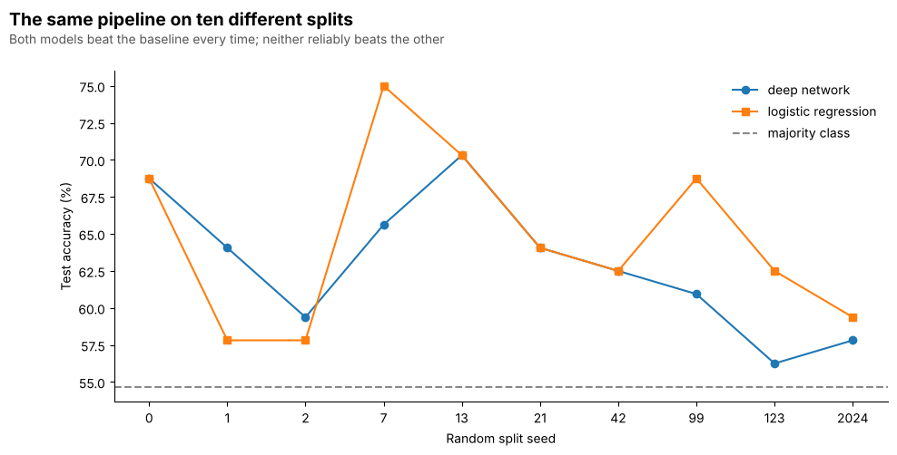

# Predicting IPO Listing Gains with PyTorch

Dataquest guided project, *Predicting Listing Gains in the Indian IPO Market
Using PyTorch*. A binary classifier that predicts, from subscription and issue
data known before listing, whether an Indian IPO will close its first trading
day above its issue price.

319 IPOs, 6 features, 54.55% of them profitable.

```
python3 -m pip install -r requirements.txt
jupyter notebook notebook.ipynb
```

The notebook in this repository is executed: every number and chart below is
its real output, not a description of what it would produce.

## The short version

The project asks for a deep network, and section 9 of the notebook delivers one
with a respectable-looking **62.50% test accuracy, 0.74 precision, 0.49
recall**.

Section 10 then asks whether the network was worth building, by rerunning the
entire pipeline across ten random splits with a logistic regression fitted on
the identical splits:

| | mean | sd | range |
|---|---|---|---|
| Deep network | 62.97% | 4.31 | 56.25 to 70.31 |
| Logistic regression | **64.69%** | 5.51 | 57.81 to 75.00 |
| Majority class | 54.69% | - | - |

**The network beats logistic regression in 2 of 10 splits.** It loses on
average. What it does do is beat the majority-class baseline in 10 of 10
splits, and so does the linear model.

So the features carry real signal, and the deep network is not the reason.

## What the data says

Correlation with the target:

```
Subscription_QIB      0.3235
Subscription_Total    0.2833
Subscription_HNI      0.2719
Subscription_RII      0.2408
Issue_Price           0.0395
Issue_Size            0.0047
```

All of the signal is in subscription demand, led by Qualified Institutional
Buyers. Institutions do the most work before committing, so heavy QIB demand
ahead of listing is the closest thing in this dataset to an informed opinion
about the company. How big the offering is and what it costs per share say
essentially nothing.

The median split is stark:

```
                    not profitable  profitable   ratio
Subscription_HNI              2.09      21.970  10.512
Subscription_QIB              1.96      16.845   8.594
Subscription_Total            2.06      16.395   7.959
Subscription_RII              2.32       6.035   2.601
Issue_Price                 220.00     272.000   1.236
Issue_Size                  450.00     540.260   1.201
```

A profitable IPO is subscribed around 8 to 10 times more heavily by
institutions and high net worth investors than an unprofitable one. The
distributions still overlap heavily, which is why no model here gets near 90%.

## Why the deep network struggles

```
trainable parameters: 897
training rows:        191
parameters per training row: 4.7
```

The network carries roughly five free parameters for every training example it
has to constrain them. The unregularized run behaves exactly as that predicts:

```
final train 72.77   val 67.19   gap 5.59
best val 67.19 at epoch 24       <- 76 further epochs bought nothing
test 60.94
```

Training accuracy climbs steadily while validation accuracy sits flat and
noisy. BatchNorm, dropout and early stopping fix the gap:

```
early stop at epoch 40
best epoch 25   best val 70.31
restored model:  train 65.97   val 70.31   gap -4.34
test 62.50
```

The restored gap is slightly **negative**, with validation above training. That
is not a bug: dropout is active during training and disabled in `eval()`, so
training accuracy is measured on a handicapped network. A small negative gap is
the expected signature of regularization working.

But regularization only stops the model inventing structure. It cannot create
information the six columns do not contain, which is why the test accuracy
moves from 60.94% to 62.50% and stops there.

## Why one number from one split is not enough

Two measurements make the single 62.50% untrustworthy, and both are cheap:

**The test set holds 64 rows.** One prediction is worth 1.5625 percentage
points. The 95% confidence interval around a 62.5% accuracy on 64 draws is
**±11.86 points**, so the honest statement is "somewhere between 51% and 74%".

**The mean gap between the two models is 1.72 points, which is 1.1 test
predictions.** Whichever model looks better on any given split is decided by
about one IPO going the other way.



The lines cross repeatedly. Neither model reliably beats the other, and both
stay above the dashed baseline throughout. That picture is the actual result of
this project, and it is not visible from a single run.

## Business reading

Precision 0.74, recall 0.49, and the model predicts "profitable" only 35.94% of
the time against an actual rate of 54.69%. It is reluctant to call a winner.

For a desk deploying capital that is the less damaging way to be wrong. A false
positive puts money into an IPO that lists down and the loss is realized. A
false negative is an opportunity not taken, costing the spread but not the
capital. A model that is picky and usually right when it speaks is more useful
here than one that flags everything.

The cost is participation: acting only on this model's positives means sitting
out roughly two thirds of IPOs.

## A detail worth catching early

The CSV's first column is named `"Date "`, with a trailing space. Left alone it
produces a `KeyError` on `df['Date']` several cells later, where the cause is no
longer obvious. The notebook strips column names immediately after loading and
prints both versions so the quirk is visible rather than lurking.

## Files

| File | Contents |
|---|---|
| `notebook.ipynb` | the full project, executed, 10 sections |
| `Indian_IPO_Market_Data.csv` | 319 Indian IPOs |
| `docs/ten_splits.png` | the ten-split comparison chart |
| `requirements.txt` | pinned dependencies |

## What would actually improve this

In order of expected value:

**More rows.** 319 IPOs is the binding constraint on everything above. No
architecture change competes with more data here.

**A time-ordered split instead of a random one.** The deployed problem is
predicting tomorrow's IPO from yesterday's. A random split lets the model learn
from IPOs that list after the ones it is tested on, which is not a capability it
would have in production. This is the single change most likely to move the
reported accuracy down and the honesty up.

**Sector and market-condition features.** Whether an IPO pops on day one
depends heavily on the market it lists into. None of these six columns observe
that at all.

## Related

The same dataset, modelled in TensorFlow for the v2.5 path, is at
[dataquest-ipo-listing-gains-tensorflow](https://github.com/Minifigures/dataquest-ipo-listing-gains-tensorflow).
This repository is the PyTorch rebuild plus the model-comparison study.
